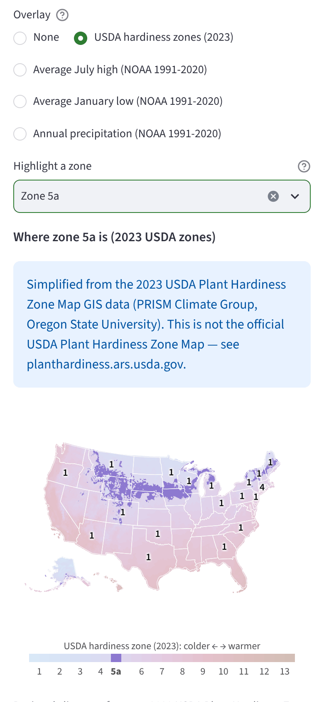
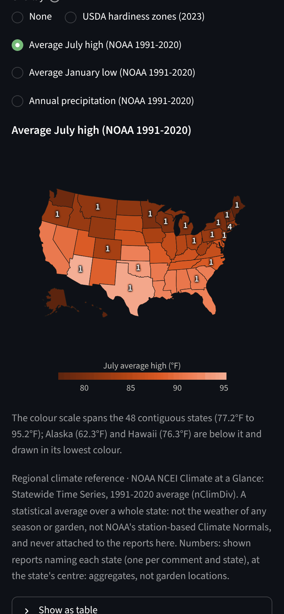
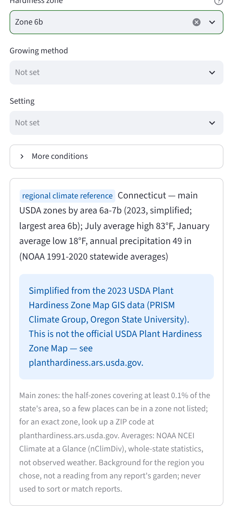

# Garden variety (crop_explorer)

A small, local, growing-environment-first explorer of gardeners' firsthand comments about crop
varieties. A visitor describes a few conditions of their own garden (region, hardiness zone,
containers or in-ground, greenhouse, hot or humid summers, ...) and searches for a crop or
variety. The app shows the actual comments, grouped by **how well the conditions the commenter
stated match the visitor's conditions**:

1. **Matching reported conditions**: every selected condition that the commenter stated agrees.
2. **Partially matching conditions**: some match; the rest were not stated or only described
   differently in the commenter's own words.
3. **Conditions not stated or not comparable**: nothing comparable was said, or only words that
   cannot be compared with yours (kept visible: unknown is not a mismatch).
4. **Different reported conditions**: at least one stated, checkable condition (zone, growing
   method, setting, sun, soil or watering) differs (collapsed, never hidden by default).

Summer heat, humidity, rainfall and season length are the commenter's own words, and they are
not calibrated across gardeners: a Minnesotan's "hot" is not a Phoenician's. So an equal value
still matches, but a report that called its summers mild is never "different" from your hot
summers. Its card quotes the words and where they were written, e.g. `In their own words:
“mild summers” (mild summers; you chose hot summers) · not counted as a difference`, and the
report sits in group 3 (group 2 if another selected condition matches; group 4 only if a
checkable condition differs). SPEC §2 names that group "Conditions not stated"; the
longer title is a deliberate small deviation, because the group also holds these
self-descriptions and words the app cannot map ("Mentioned as written, not comparable").

Every condition on a card links to the exact passage of the comment it came from, and the
app always says plainly how few reports describe their growing conditions at all.

**What it is not.** It does not recommend varieties, score them, rank them by quality, predict
success, or summarise opinions with a model. A failure reported under conditions like yours is
exactly as relevant as a success. Matching is deterministic application logic over facts that
were extracted offline and checked against the comment text; no model is called when someone
searches. A hardiness zone is not treated as a climate, and a state is not treated as proof of
similar growing conditions.

The product spec is [`SPEC.md`](SPEC.md); the binding module contracts are in
[`docs/ARCHITECTURE.md`](docs/ARCHITECTURE.md).

## Quickstart

Requires [uv](https://docs.astral.sh/uv/) (it installs Python 3.12+ and the locked
dependencies).

```bash
uv sync                                    # install the locked environment
uv run python -m crop_explorer demo        # build data/crop_explorer.sqlite from the synthetic fixtures
uv run streamlit run app.py                # open the public-safe demo viewer
```

The demo loads 69 fictional comments (`fixtures/synthetic_comments.jsonl`) and their
extractions, imported with rights status `synthetic`; the viewer labels them as demo data. See
[`fixtures/SCENARIOS.md`](fixtures/SCENARIOS.md) for what each one exercises. None of them is a
real comment: to explore the real, current comments of a video, import them with
`fetch-youtube` into a database without the demo (see "Importing a YouTube video's comments").

To browse your own private imports on this computer only (never for publication):

```bash
uv run streamlit run app.py --server.address localhost -- --scope private
```

The viewer has no accounts, so a private view refuses to run (an error, no comments) unless
the server listens on this computer alone: the private command must include
`--server.address localhost`, and without it the viewer refuses to show anything.
`.streamlit/config.toml` deliberately sets no server address or port (Streamlit Community Cloud
must choose both, see below), so without that flag Streamlit listens on every network
interface, which only a **public**-scope view may ever do. Add `--server.address localhost` to
the public command too if you want to keep it on this computer.

Viewer options go after `--`: `--scope {public,private}`, `--db PATH` and `--config PATH`. An
unknown or mistyped option (for example `--database`) stops the viewer with an error instead of
silently opening the default database. If the database does not exist yet, or was created by an
older version (see "Upgrading" below), the app says so and shows the `demo` command instead of
creating an empty one.

What the Browse screen offers: Region, Hardiness zone, Growing method and Setting are always
visible; summer heat, humidity, rainfall, season length, sun, soil and watering sit under
"More conditions" (its label lists any that are set). Quick chips ("Containers", "Hot &
humid", ...) appear only when enough reports support them, and their tooltip says how many
state any and how many state all of the chip's conditions (for heat, humidity, rainfall or season
length, how many "describe" them "in their own words"). Under the search box, **Crop |
Topics | Year grown** are hard filters ("Showing only reports that say they grew in 2023", with
an "Any year" reset). Each card carries a `community report` badge and, when they show a comparable condition the
commenter stated, its condition lines a `reported conditions` badge (a stated region alone is
not a comparable condition, so it gets no badge and does not count in "Only N of M reports
mention comparable growing conditions"); a comment that has not been extracted yet reads "Not yet analysed
for growing conditions", and a condition stated in words the app cannot compare reads
"Mentioned as written, not comparable: soil "rocky hillside dirt"". Each result group shows
`viewer.page_size` cards at a time with a "Show N more" button. "Optional outside context"
(official references, published trials and outside gardeners' ratings, each badged) sits just
above the Comments and Map tabs; the USDA zone map and NOAA rows say they are "also available
as a map overlay". Choosing a U.S. state as Region shows a small **regional climate
reference** box under the conditions (see "Regional climate overlays" below).

**At a glance.** Above "My growing conditions", a header shows what the community shared,
counted over the visible reports only (the public view never counts private imports). Four stat
tiles (four across, two by two on a phone): **Reports**, **Varieties mentioned** ("across 8
crops"), **Describe conditions** ("33 of 69", with a meter; any comparable condition such as
zone, method or heat, the same definition as "Only N of M reports mention comparable growing
conditions") and **Places named** (U.S. states and places outside the U.S.). Three short tabs,
each chart directly under its tab with its caption below: **Varieties** (comments naming each of
the top `overview.top_varieties` varieties, one bar colour, the count at each bar's tip),
**Topics** (a grid of comments per variety and topic for the first
`overview.heatmap_varieties` of those varieties, on a one-hue blue scale with a "Comments"
legend; the catch-all "General" is always the last column) and **How people grow** (comments
stating each growing method and setting). Every number is a count of distinct comments: it
measures conversation, never quality, and the captions say so ("a failed crop counts the same
as a great one"; "most don't say"). When the cut at the top 10 splits varieties with equal
counts, the caption says how many more have that count and that ties are listed
alphabetically. Each chart has one hover readout per bar or cell and a "Show as table" view.

Clicking a variety's bar (anywhere on its row) shows **exactly the reports that bar counts**: it
sets a variety filter (every spelling of that variety, so "Sun Gold" and "Sungold" both count)
and clears the search text and the Crop, Topics, Year and state filters, while your garden
conditions stay as they are. Clicking a grid cell does the same and sets Topics to that topic.
A line right above the chart then names what is shown, with a "Go to the reports ↓" link, and
the results start with "Showing only reports that mention Sungold · tomato (all spellings)."
and an "Any variety" button (Clear resets it too). On a touch screen Plotly selects a bar on
the second tap (the first tap shows its count), so phones get the hint "Tap a bar once to see
its count, then tap it again", and mouse users "Click a bar". The charts use their own light
and dark colour tokens, chosen from Streamlit's theme (`.streamlit/config.toml` sets an accent
per mode so the viewer follows the visitor's system setting), and the page's own typeface;
variety names from comments are escaped before Plotly sees them, and long names are shortened
with "…" on the axis (the hover and the table keep the full name).

## Host the public demo on Streamlit Community Cloud

[`streamlit_app.py`](streamlit_app.py) is the entrypoint for a free, public
[Streamlit Community Cloud](https://streamlit.io/cloud) app. It only ever shows the bundled
synthetic comments: once per server process (on the first visit after the app starts) it
rebuilds the demo database from `fixtures/` in a fresh temporary directory and runs the normal viewer in **public** scope
against it. It never opens `data/` or any other database, and it ignores command-line
arguments and the scope in `config.yaml`, so a private import can never be served from it.

1. Sign in at [share.streamlit.io](https://share.streamlit.io) with GitHub.
2. **Create app**, then **Yup, I have an app**.
3. Repository `SamuelBrudner/garden-comments`; branch `feat/mvp-v0.5` (or `main` after
   merging); main file path `streamlit_app.py`.
4. **Advanced settings**: Python version **3.12**.
5. **Deploy**.

Cloud runs the app from the repository root, reads the root `.streamlit/config.toml` (which
sets no server address or port, because Cloud health-checks the app on `localhost:8501` and
proxies visitors to it) and installs the dependencies from the root `uv.lock`, the first
dependency file it finds. No secrets are needed. The maps' U.S. base map (state outlines) is
served by the app itself from `static/topojson/` (`server.enableStaticServing` in
`.streamlit/config.toml`), so visitors' browsers never fetch it from Plotly's CDN.

If the build log shows the package or a dependency failing to install, the documented escape
hatch is a `requirements.txt` listing the runtime dependencies of `pyproject.toml`. Cloud only
uses it if it finds it before `uv.lock`: it searches the entrypoint's directory first, then the
repository root, and in each one `uv.lock` outranks `requirements.txt`. With `streamlit_app.py`
at the root next to `uv.lock`, that means moving the entrypoint into its own folder (with the
`requirements.txt` beside it). The entrypoint imports the package from `src/` itself, so it
works whether or not Cloud installs this project.

## Working with real comments (CLI round trip)

Real comments are imported as **`private_unverified`** and are only ever visible in the private
local view. Extraction is an offline model step: you run a capable model (Codex, Claude or
similar) yourself with the instructions in
[`docs/EXTRACTION_PROMPT.md`](docs/EXTRACTION_PROMPT.md); no hosted-model API is required by
the app.

```bash
# 1. Import a CSV or JSONL export as one private source (idempotent; re-run after updates).
#    The source id defaults to the file stem, so give each export its own --source-id.
#    Columns default to comment_id and text, plus permalink and created_at when present.
#    Map others with --id-col and --text-col; --permalink-col / --date-col name an optional
#    column that must then exist (a typo is an error, never a silent "no links / no dates").
#    --expires-at sets a rights expiry (see "Rights and the publication gate").
#    For a YouTube video, fetch-youtube writes this file (see "Importing a YouTube video's
#    comments").
uv run python -m crop_explorer ingest data/comments.csv --scope private --source-id my-export

# 2. Export what still needs extraction: an owner-only (0600) JSONL file of
#    {"comment_id", "text", "text_hash"} lines. text_hash is the SHA-256 of the exact text.
uv run python -m crop_explorer export-for-extraction --out data/to_extract.jsonl --only-unparsed

# 3. Model step (offline): follow Part 2 of docs/EXTRACTION_PROMPT.md over
#    data/to_extract.jsonl and write data/parsed_comments.jsonl (one ParsedComment per line).
#    The model must copy each line's comment_id AND text_hash unchanged into its output.

# 4. Validate against the stored text and load. Prints counts only; every rejection is
#    written as {comment_id, line_number, mention_index, fact_index, reason}.
uv run python -m crop_explorer load-extractions data/parsed_comments.jsonl \
    --rejections-out data/rejections.jsonl

# 5. Browse privately, on this computer only.
uv run streamlit run app.py --server.address localhost -- --scope private
```

`ingest` options for re-imports:

- Re-running `ingest` for the same source refreshes it: changed comments are updated, missing
  ones deleted. A re-import **without** `--expires-at` keeps the stored expiry (leaving the flag
  out never lifts it); `--clear-expiry` removes it, and it cannot be combined with
  `--expires-at`. A source whose expiry has passed cannot be re-imported until it is removed
  with `purge-expired` or `delete-source`.
- `--replace` is required to load a **different** export under an existing source id (an
  import sharing no comment id with what is stored, for example a second file that is also
  called `comments.csv`) or to change a stored source's `--scope`. Without it the command
  exits 2 and changes nothing.
- The JSON printed by `ingest` reports the counts and the source's effective `rights_status`
  and `expires_at`.

What the loader keeps (anything it cannot verify is rejected and listed with a reason code):

- Each line's `text_hash` must equal the stored text's hash. An extraction made from an older
  version of a comment is rejected as `stale_text` and writes nothing; re-run step 2 with
  `--only-unparsed` to export the new text. Lines for unknown ids, ids repeated in the file and
  comments whose source has expired are rejected too (`unknown_comment_id`,
  `duplicate_comment_id`, `source_expired`).
- Every evidence quote must be an exact substring of the stored comment, and variety names and
  values must occur in their quote as whole words ("Roma" is not in "aroma", "Maine" is not in
  "remained"). A crop-only mention must name its crop in its quote (`crop_not_in_quote`).
- A value is judged **where it occurs in its quote**: a negated phrase ("it wasn't humid") is
  `negated_value`; a look-alike ("clay pots", "Kansas City", "Perth, WA", "Lake Michigan",
  "Sunset zone 9") is `blocked_value`; a different value, a longer place or a range there
  ("Virginia" in "West Virginia", "zone 6b" in "zone 6b/7a") is `normalized_value_mismatch`.
  Region, zone and year values must be readable by the loader where they are quoted
  (`strict_key_mismatch`). A place named inside a variety name ("Arkansas Traveler") is
  `value_in_variety_name`. An occurrence inside a look-alike or a variety name is skipped when
  another occurrence in the quote states the value ("I live in Michigan near Lake Michigan"
  keeps `US-MI`); every other occurrence must agree. A low-quantity word (less, lack, rarely,
  seldom, zero) negates only the value it directly qualifies ("less humid", "it rarely
  rained"), never a region, zone or year ("Zero problems in zone 6b" keeps `6b`).
- A `normalized_value` of `null` is never filled in: such a fact is shown as written but never
  used for matching.
- Facts quoted from advice, plans, wishes or questions ("I'd try these in zone 5", "Wish I had
  a greenhouse", "Does it do well in zone 6b?") are rejected (`hypothetical_context`,
  `question_context`), as are whole-comment regions or zones that disagree across mentions
  (`conflicting_region`, `conflicting_zone`). The markers are phrases, not bare words: "would
  be", "i wish", "has anyone", and "maybe" only at the start of a sentence, so an estimate
  ("gets maybe 7 hrs of full sun") or a habit ("would wilt every afternoon") is kept.

A rejected fact never removes the comment from full-text search. Re-loading the same file is
idempotent; re-importing a comment with changed text drops its old extraction. The full rule
list is in `docs/EXTRACTION_PROMPT.md` and `docs/ARCHITECTURE.md`.

Other commands:

```bash
uv run python -m crop_explorer summary [--scope public|private]   # what a viewer can see (counts)
uv run python -m crop_explorer delete-source my-export            # remove a source and everything derived from it
uv run python -m crop_explorer purge-expired                      # delete sources whose --expires-at has passed
uv run python -m crop_explorer --help
```

Every command prints one line of JSON with ids and counts and exits 0; invalid input prints one
`error: ...` line to stderr and exits 2. Comment text is never printed or logged; only
`export-for-extraction` and `fetch-youtube` write it, to owner-only files. `--out` and
`--rejections-out` are checked before anything is read, loaded or fetched: they refuse a
directory, a symlink, the database
(and its `-wal`/`-journal`/`-shm` files) and, for `--rejections-out`, the input file.
`--db PATH` and `--config PATH` work with every command. Options must be spelled out in full
(an abbreviation such as `--only` is refused), and a usage error names an unrecognized option
but never repeats a value given with it.

The database holds comment text verbatim: a new database file is created owner-only (0600), in
a directory created owner-only (0700) when missing. Deleting or purging a source also removes
its words from the full-text index and zeroes the freed pages.

**Upgrading.** Databases record a schema version. A database created by an earlier version of
this code (or by another program) is refused with "unsupported database schema"; rebuild into
a new file (`demo`, or `ingest` + `load-extractions` again with `--db new.sqlite`). Crop names
and variety grouping keys are normalised at load time, so re-loading extractions also refreshes
them (since this version a variety key ignores spaces and hyphens, so "Sun Gold" and "Sungold"
group together and a search for either finds both; the viewer always shows the name as
written).

## Importing a YouTube video's comments

`fetch-youtube` downloads every public comment and reply under one video through the official
[YouTube Data API v3](https://developers.google.com/youtube/v3/docs/commentThreads/list) and
writes a JSONL file that `ingest` reads unchanged. It needs an API key of your own. In the
[Google Cloud console](https://console.cloud.google.com/), create or pick a project, enable
**YouTube Data API v3**, create an **API key** (APIs & Services, Credentials) and set its
restrictions: **API restrictions**: restrict the key to YouTube Data API v3; **Application
restrictions**: **None** (or **IP addresses**). A key restricted to websites (HTTP referrers),
Android apps or iOS apps is refused for a command-line tool, which sends none of those. **Never
paste the key into a chat (an AI assistant included), an issue, a config file, a command line
or a commit.** If it leaks, delete it in the console and create a new one. Then give the key to
the command in one of two explicit ways (there is no fallback from one to the other):

1. **Environment variable (the default).** Put the key in the variable named by
   `youtube.api_key_env` (default `YOUTUBE_API_KEY`), in your own terminal. If it is missing
   or empty the command stops before any request with an error naming the variable (and the
   `--key-via-proxy` alternative), never its value.

   ```bash
   read -rs YOUTUBE_API_KEY && export YOUTUBE_API_KEY   # paste the key: not echoed, not in shell history
   uv run python -m crop_explorer fetch-youtube 'https://www.youtube.com/watch?v=GUmvL7s6b2w' \
       --out data/youtube-GUmvL7s6b2w.jsonl
   ```

2. **Network secret (`--key-via-proxy`).** In a cloud environment whose network proxy can
   attach secrets to outgoing requests (for example Claude Code on the web: the environment's
   settings, **Network secrets**), add a secret for the host `www.googleapis.com` with the
   header `X-Goog-Api-Key` and the key as its value; a new session picks it up. Run the command
   with `--key-via-proxy`: it reads no variable and sends no key, and the proxy adds the header
   on the way out, so the key never enters the session at all. If the secret is missing, the
   API answers 403 "unregistered callers" and the command says so: `error: YouTube Data API
   error (HTTP 403, forbidden): the request reached the API without an API key ("unregistered
   callers"): with --key-via-proxy this means the network proxy has no network secret ...`.

   ```bash
   uv run python -m crop_explorer fetch-youtube GUmvL7s6b2w --key-via-proxy \
       --out data/youtube-GUmvL7s6b2w.jsonl
   ```

Keep `--out` under `data/`, which git ignores: **never commit fetched comments.** The video may
be given as its 11-character id, a `youtube.com/watch?v=ID` URL or a
`youtu.be/ID` URL; anything else is refused. The command prints one line of JSON: `threads` and
`replies` (distinct top-level comments and replies written), `rows` (their sum, the lines in the
file), `api_pages` (requests made, i.e. quota units spent), `out`, `fetched_at`, `expires_at` and
`ingest_command`, the exact next step. Run that command as printed; it looks like this:

```bash
uv run python -m crop_explorer ingest data/youtube-GUmvL7s6b2w.jsonl --scope private \
    --source-id youtube-GUmvL7s6b2w --kind youtube_comments \
    --source-url 'https://www.youtube.com/watch?v=GUmvL7s6b2w' --expires-at 2026-11-19T12:00:00Z \
    --replace
```

`--config PATH` (unless it is the default) and `--db PATH` given to `fetch-youtube` are
repeated in the printed command, so the comments land in the database you named, the one your
`purge-expired --db PATH` cleans. `--replace` is there because the source id is the video's:
a re-fetch is always the same dataset, even when none of the comments stored before is still on
the video. A video without public comments is an error (`video ... has no public comments:
nothing to import`, exit 2): no file is written and no command printed.

**Real comments only.** The `demo` database holds 69 made-up comments. To explore only the
video's real comments, import them into a database of their own, then browse it privately:

```bash
uv run python -m crop_explorer --db data/youtube.sqlite fetch-youtube GUmvL7s6b2w \
    --out data/youtube-GUmvL7s6b2w.jsonl      # prints the ingest command, with --db data/youtube.sqlite
# run the printed ingest command, then:
uv run streamlit run app.py --server.address localhost -- --scope private --db data/youtube.sqlite
```

(Or remove the demo from the default database first: `uv run python -m crop_explorer
delete-source synthetic-demo`.) Then continue with step 2 of the round trip above
(`export-for-extraction`, with the same `--db`) so the viewer can group the comments by variety
and conditions; until then it lists them as not yet analysed for growing conditions.

- **What is written.** One row per comment with exactly `comment_id`, `text` (the API's
  plain-text `textDisplay`, kept exactly), `permalink`
  (`https://www.youtube.com/watch?v=<video>&lc=<comment id>`) and `created_at` (`publishedAt`).
  Replies are rows of their own, right after their thread, in the API's order; a comment id
  seen twice is written once (the first copy). No author names, channel ids, avatars, like
  counts or other metrics are written. The file is owner-only (0600) and as private as the
  database: it holds comment text verbatim.
- **Private only.** Import with `--scope private`, as the printed command does:
  `private_unverified` comments never reach a public viewer. Being able to fetch comments does
  not clear them for publication (see "Rights and the publication gate").
- **30 days at most.** The [YouTube Developer
  Policies](https://developers.google.com/youtube/terms/developer-policies) allow API data
  that is not refreshed to be stored for at most 30 days. The printed command sets
  `--expires-at` to the fetch time plus `youtube.retention_days` (1-30, default 30). After that
  the source disappears from every view and `purge-expired` deletes it: run `purge-expired`
  regularly (for example daily, with the same `--db`). It cleans the database only. Every
  **file** made from the fetch holds API data too and must be deleted by `expires_at` as well:
  the fetched JSONL (`data/youtube-<video>.jsonl`), the `export-for-extraction` file
  (`data/to_extract.jsonl`, the comment text verbatim), the model's output
  (`data/parsed_comments.jsonl`, quotes from it) and `data/rejections.jsonl` (comment ids). To
  keep a video longer, fetch it again before it expires and run the new `ingest` command: that
  refreshes the stored comments (comments removed from the video are removed here too) and
  moves the expiry. An expired source must be purged before it can be imported again.
- **Quota.** Every API page costs one unit of the key's daily quota (10,000 units by default,
  reset at midnight Pacific Time). A page holds up to `youtube.page_size` (100) threads; a
  thread with more replies than the few the API includes inline costs at least one more page.
  `youtube.max_pages` (default 1000) caps one fetch: a video that needs more fails with an
  error instead of being cut short.
- **Errors.** An API error prints one line with the HTTP status and reason, e.g. `error: YouTube
  Data API error (HTTP 403, commentsDisabled): comments are turned off for this video` (also
  `videoNotFound`, `quotaExceeded`, `keyInvalid`, `forbidden`, ...), and exits 2. Key problems
  that Google reports in the error's details are named and explained too: `API_KEY_INVALID`
  (check the variable or the network secret), `API_KEY_HTTP_REFERRER_BLOCKED` and the other
  application-restriction refusals (set **Application restrictions** to None or IP addresses),
  `API_KEY_SERVICE_BLOCKED` (the key's API restrictions leave out YouTube Data API v3) and
  `SERVICE_DISABLED` (the API is not enabled in the project). A failed fetch writes nothing:
  `--out` is checked before the first request (a directory, a symlink and the database are
  refused) and opened only after the last page, so an earlier file stays as it was.
- **The key stays out of everything.** Read from the environment, it is sent only in the
  `X-Goog-Api-Key` request header, and only to Google's API hosts: `youtube.api_base_url` must
  be on `www.googleapis.com` or `youtube.googleapis.com` (no other host or port is accepted).
  It never appears in a URL, a log line, an error message, the output file or the printed
  command, and there is no option to pass it on the command line (`fetch-youtube --help` names
  the variable; a mistyped `--key=...` is refused without repeating the value). A configuration
  error never repeats the value of the setting either, in case a key was pasted into the wrong
  place. With `--key-via-proxy` the command never holds the key. Redirects are refused, so the
  header is never forwarded to another address. Requests use the standard library (`urllib`,
  which honours `HTTPS_PROXY`). Logs carry counts only, never comment text.

## Rights and the publication gate

The first deliverable is a **private local prototype**, not a public copy of anyone's comments
(SPEC §9). Each imported source carries a rights status:

| `ingest --scope` | Rights status | Public viewer | Private viewer |
|---|---|---|---|
| `private` | `private_unverified` | never | yes, with a "do not publish" banner |
| `synthetic` | `synthetic` (fictional demo data) | yes, labelled as demo data | yes |
| `cleared` | `cleared` | yes | yes |

- `private_unverified` content never reaches a public result, count, quick chip, filter option,
  map cell, snippet or cache. Every viewer-facing database read applies one shared rights and
  expiry clause (`crop_explorer.visibility`), and the viewer never caches query results. The
  private view itself only runs on a loopback address (see Quickstart).
- The public-safe mode is the synthetic demo. Use `--scope cleared` only after the specific
  distribution and storage workflow for those comments has been cleared. A creator's approval
  does not by itself grant permission to republish other people's comments, and it does not
  override platform terms. Synthetic rows never get a source link, even if they carry one.
- Sources can carry an expiry (`--expires-at`): expired sources disappear from every view
  immediately, are skipped by `export-for-extraction`, have their extraction lines rejected,
  and are removed by `purge-expired`. A later `ingest` without `--expires-at` keeps the expiry.
  `delete-source` cascades through comments, extractions, search index, counts and map.
- Before any public use of YouTube-derived content, review:
  [YouTube Developer Policies](https://developers.google.com/youtube/terms/developer-policies),
  the [Developer Policy Guide](https://developers.google.com/youtube/terms/developer-policies-guide)
  and the [derived metrics policy](https://developers.google.com/youtube/terms/derived-metrics-policy).
- Do not imply creator endorsement or use channel branding without permission.
- `data/` (database, logs, exports, model output) is git-ignored. Exports and model output
  contain verbatim comment text and are as private as the source.

### Privacy policy and terms of use

The foot of every Browse page, the hosted demo included, reads: "By using this site you agree
to its Terms of use and Privacy policy", linking `?page=terms` and
`?page=privacy`. Each opens (in a new tab) that page instead of the comments; "Back to the
comments" returns. Any other `?page=` value is an error. The texts are
[`src/crop_explorer/data/legal/privacy.md`](src/crop_explorer/data/legal/privacy.md) and
[`terms.md`](src/crop_explorer/data/legal/terms.md). They cover what the
[YouTube Developer Policies](https://developers.google.com/youtube/terms/developer-policies)
ask of an app that shows YouTube API data: a link to the YouTube Terms of Service and
agreement to be bound by them (III.A.1); a privacy policy, reachable from every page, that says
the app uses YouTube API Services, links the Google Privacy Policy and says what information is
accessed, used, stored and shared, and with whom, including that comment text is sent to an AI
model for extraction (III.A.2). Having them does **not** clear any comments for publication
(see above). Edit them when what the app collects, stores or shares changes, and update their
"Last updated" date.

## Configuration

`config.yaml` (validated by `crop_explorer.config.AppConfig`; relative paths resolve against the
config file):

| Key | Meaning |
|---|---|
| `database.path` | SQLite file (default `data/crop_explorer.sqlite`; `--db` overrides it). |
| `viewer.scope` | Default viewer scope, `public` (fail-safe) or `private`. |
| `viewer.min_reports_for_chip` | A quick chip ("Containers", "Hot & humid", ...) appears only when at least this many visible reports state at least one of its conditions. |
| `viewer.max_query_chars` | Longest search text accepted (the search box is capped; it bounds full-text search cost). |
| `viewer.page_size` | Cards shown per result group before "Show N more". |
| `overview.top_varieties`, `overview.heatmap_varieties` | How many most-discussed varieties the "At a glance" bar chart lists (default 10), and how many of those same varieties, in the same order, the topic grid shows (default 8; at most `top_varieties`). |
| `map.public_min_cell_count` | In public scope, map cells with fewer reports are drawn as "fewer than k". This **only coarsens the map display**: cards still show each comment's text and region, and filtering by that state still lists the reports, so it is not a privacy control. Only publish comments whose source is cleared. |
| `map.height_px`, `map.zone_mute` | Height of the map in pixels (200-1200; the report-count map and every overlay, scale legend included), and how far the other zones fade toward the background when one zone is highlighted on the zone overlay (strictly between 0 and 1). There is no default-overlay setting: overlays are always off until the viewer picks one (SPEC §7). |
| `extraction.hypothetical_markers` | Phrases that make a sentence advice, a plan or a wish; facts quoted from such sentences (and from questions) are rejected. A marker starting with `^` (`^maybe`) counts only at the start of a sentence. Keep the list in `docs/EXTRACTION_PROMPT.md` Part 2 in step (a test checks it). |
| `quick_chips` | Label plus the garden conditions each chip sets. |
| `outside_context` | Opt-in outbound links, each badged with its evidence type: `regional climate reference` (USDA zone map, NOAA normals, NASA climatology), `published external trial` (university variety trials) or `community report` (outside gardeners' own ratings, e.g. Cornell's Vegetable Varieties for Gardeners; never this channel's comments). `reported conditions` is not allowed here, and a government host (`*.gov`, `*.mil`, `*.gov.au`, `*.gc.ca`, ...) can never be labelled `community report`. Optional `overlay: zones` or `overlay: normals` marks a regional climate reference whose kind of data is also a map overlay (its row then says "Also available as a map overlay"); only a `regional climate reference` may have one. |
| `youtube.api_base_url`, `youtube.page_size`, `youtube.timeout_s`, `youtube.max_pages`, `youtube.retention_days`, `youtube.api_key_env` | `fetch-youtube`: the API root (https only, on `www.googleapis.com` or `youtube.googleapis.com`, no port), comments per API page (1-100), seconds each request may take, the most API pages one video may need (more is an error, never a truncation), the days fetched comments may be kept (1-30; the printed `--expires-at`), and the name of the environment variable holding the API key (upper case, never the key itself; not read with `--key-via-proxy`). |
| `logging.level`, `logging.json_path` | Loguru level and optional JSON-lines log file (never receives comment text). |

## Testing and quality

```bash
uv run playwright install chromium                         # once: the browser for tests/test_browser.py
uv run pytest                                              # whole suite (unit, property, CLI, AppTest, browser)
uv run pytest -m "not browser"                             # everything except the real-browser test
uv run pytest --cov=crop_explorer --cov-report=term-missing
uv run ruff check .
uv run ruff format --check .
uv run mypy                                                # strict, over src/, app.py and streamlit_app.py
uv run pre-commit run --all-files                          # ruff, format and mypy, as in CI
```

Tests were written first and use synthetic comments only. They include Hypothesis property
tests for the pure logic (normalisation, matching, grouping, visibility, escaping), every SPEC
§11 acceptance case (`tests/test_acceptance.py`, including end-to-end validator cases pushed
through `load-extractions`), rights-isolation checks across search, chips, filters, counts and
the map, and Streamlit `AppTest` runs of the viewer and of the hosted demo entrypoint
(`tests/test_streamlit_app.py`: public scope, its own database, never a user's). SPEC §11 #17 (phone width, resets, source
references) is covered by `tests/test_app.py` (Clear, the "Source ↗" link of a cleared comment,
the synthetic and no-link notes) and by `tests/test_browser.py`: it starts `streamlit run`
headless on a free loopback port and drives Chromium at 390x844 (no sideways scrolling, search
box and the always-visible selects on screen, a zone choice regroups the reports, Clear restores
the first-load labels, the source link's address, the "At a glance" tiles two by two with all
three tab labels on screen and the first bars above the fold), then desktop checks (tiles four
across; one hover box per row; clicking a variety bar or a topic cell shows exactly the reports
it counts, names them above the chart and links down to them) and a touch-screen check (the
touch hint shows; two taps on a bar show its reports), the hardiness-zone overlay at 390x844
(zones, state outlines and count labels drawn with no network, the disclaimer on screen, no
sideways scrolling) and the base map and zone layer served by the app. `tests/test_overlay_charts.py` checks
the overlay figures (one fill and one scale legend, the zone layer named by URL, count labels
only for states with reports and never with coordinates, suppressed counts never shown, the
zone emphasis and its configured fade, the NOAA scale spanning the contiguous states, light and
dark tokens, escaping), their tables and the regional box's wording; `tests/test_app.py` checks
the overlay picker (off by default), "Highlight a zone" (a view option that never sets a
condition or changes the results), each overlay's badge, source, period, disclaimer and table,
that public counts never include private rows, that the state filter still works, that a
missing served zone layer is an error, and that the regional box appears only for a chosen
region and never on a card. The browser test is
marked `browser`, takes about 40 seconds and needs Playwright's Chromium (`uv run playwright
install chromium`; CI uses `--with-deps`); deselect it with `-m "not browser"`.
`tests/test_code_standards.py` fails for any function in `src/`, `app.py` or `streamlit_app.py`
with more than 15 code lines. The `fetch-youtube` tests serve invented API pages
(`tests/synthetic_youtube.py`) through an injected transport and fail on any real network
connection. `tests/test_prompt_consistency.py` keeps Part 2 of `docs/EXTRACTION_PROMPT.md` in
step with the code: its marker list, rejection codes, region codes and aliases, documented
phrasings, look-alikes and crop synonyms must match what the loader reads, and its worked
example must load with zero rejections. CI (`.github/workflows/ci.yml`) runs the pre-commit hooks, installs Chromium and
runs the tests with coverage.

## Regional climate overlays

Outside resources such as hardiness zones are **optional overlays**, not just links. They are
**regional climate references** (SPEC §7): background for a region, never evidence about a
variety, a report or a commenter.

**On the map.** The Map tab has an **Overlay** choice: **None** (the default: the report-count
map, unchanged), **USDA hardiness zones (2023)**, **Average July high (NOAA 1991-2020)**,
**Average January low (NOAA 1991-2020)** and **Annual precipitation (NOAA 1991-2020)**. With an
overlay on, it is the map's only fill; the state outlines stay, and the shown reports become
one number per state that has any (an aggregate placed at the state's centre, never a garden
location). Reports that give only a hardiness zone are never placed on the map. Each overlay
is badged `regional climate reference` and names its source and period under the map, with a
scale legend and a "Show as table" twin. Hovering a state gives its value (zones: the state's
main zones by area) and, on its own line, "Reports naming this state: 4 (zones are not
assigned to reports)". Clicking a state, or the "Filter by reported state" box, still filters
the reports.

<p>



</p>

More screenshots (phone and desktop, light and dark) are in `docs/img/`.

The zone layer shows, above the map and again above its tables, the required disclaimer
"Simplified from the 2023 USDA Plant Hardiness Zone Map GIS data (PRISM Climate Group, Oregon
State University). This is not the official USDA Plant Hardiness Zone Map — see
planthardiness.ars.usda.gov." Its colours run cold (blue) to warm (red) with lightness always
increasing one way (the "semantic heat" exception to one-hue ramps, always with a scale
legend). Only the seven anchor colours pass the palette validator's ordinal checks; the 26
half-zone steps between them are, by design, too close to tell neighbouring half-zones (6a/6b)
apart by colour alone. So the zone layer has a **Highlight a zone** box under the Overlay
choice: pick any zone or half-zone and it keeps its colour while every other zone fades, on the
map and in the legend ("Where zone 5a is (2023 USDA zones)"). Left empty, it highlights the
hardiness zone you chose under My growing conditions, if any. It is a view option only: it
never sets your zone, never changes the results, and Clear leaves it alone. Its tables: each
state's main zones by area (the half-zones covering at least 0.1% of the state), each state's
share per half-zone (one row per state and zone, the share as a number), and the zone key.

The NOAA layers use one orange ramp (blue already means "reports"), as sequential maps whose
scale spans the 48 contiguous states, so they use the whole ramp; Alaska and Hawaii take its end
colours when outside it, and a line under the map says so ("Alaska (62.3°F) and Hawaii (76.3°F)
are below it and drawn in its lowest colour"); their exact values are in the hover and the
table. Light and dark modes have their own steps. Overlays never change the results: zones are
never assigned to reports, and no climate value is attached to a comment.

**Under My growing conditions.** Choosing a U.S. state as Region shows a compact box, e.g.
"Connecticut — main USDA zones by area 6a-7b (2023, simplified; largest area 6b); July average
high 83°F, January average low 18°F, annual precipitation 49 in (NOAA 1991-2020 statewide
averages)", with the zone disclaimer in its own info box, then what "main zones" means (a few
places can be in a zone not listed; look up a ZIP code at planthardiness.ars.usda.gov for an
exact zone) and the sources. It describes your chosen region only: it never sorts or matches
reports and never appears on a card. DC has no NOAA statewide series, and a region outside the
U.S. gets a line saying no reference is available.

**NASA POWER stays a link.** SPEC §7 makes it a P2 "only if it adds real usefulness": the NOAA
statewide averages already cover the same variables (temperature, precipitation) for the same
regions, and a POWER overlay would need either request-time API calls (not allowed) or a
gridded climatology build for a state-level map that cannot show its resolution. Cornell's and
Nebraska's trial and gardener resources stay labelled links (no bulk rehosting).

**The data** (`src/crop_explorer/data/overlays/`) are small, attributed files built offline:
simplified 2023 USDA Plant Hardiness Zone half-zone polygons (contiguous U.S., Alaska and
Hawaii, 0.9 MB), each state's half-zone shares, and statewide 1991-2020 averages of three NOAA
nClimDiv series (Climate at a Glance; statistical averages computed by this project, not
NOAA's station-based Climate Normals and not observed weather). The zone geometry is altered
(simplified) from the PRISM/OSU GIS data, so under the PRISM/OSU terms every display carries
the disclaimer above and no USDA-ARS or OSU logo is used anywhere. Sources, terms (verbatim),
retrieval dates, checksums and tolerances: `NOTICE.md` and `sources.yaml` in that folder. The
app loads them once per server process (`st.cache_resource`; query results are never cached)
and makes no network call for them; a corrupt file is reported where it would show while the
rest of the page keeps working.

**Served to browsers.** Plotly draws nothing on a map (not even the zone polygons) until it
has loaded its U.S. base map. The app serves that file, Plotly's own `usa_110m.json`
(unchanged, MIT; provenance in `static/topojson/NOTICE.md`), from `static/topojson/` and sets
Plotly's `topojsonURL` to it, so maps draw on phones and networks that cannot reach
`cdn.plot.ly`. The zone figure names its polygons by URL too: `static/overlays/` holds a
byte-identical copy of the packaged zone layer (the app checks this at start-up and shows an
error instead of the overlay if the copy is missing or stale), so the 0.9 MB GeoJSON is fetched
once and cached by the browser instead of being copied into every figure and resent on every
rerun. Run the app from the repository root (where `.streamlit/config.toml` turns on static
serving).

On a 390x844 phone viewport with 4x CPU throttling (demo data), switching the map to the zone
overlay draws in about 2.2 s (its largest main-thread task about 1.0 s, drawing 1.9 million
characters of SVG path), a NOAA overlay in about 1.2 s; scrolling over the map drops no frames.
Building a zone figure costs the server about 60 ms and sends about 19 KB.

To rebuild the overlay data (network; geometry tools come from the optional `overlays`
dependency group and are never imported by the app; with the default output folder the script
also refreshes the browser copy in `static/overlays/`):

```bash
uv run --group overlays python -I scripts/build_overlays.py --download-dir ~/.cache/crop_explorer/overlay-downloads
uv run pytest tests/test_overlays.py tests/test_overlay_charts.py -q
```

## Project layout

```text
├── SPEC.md                       # product spec (v0.5)
├── config.yaml                   # runtime configuration
├── app.py                        # Streamlit Browse screen (thin; logic lives in the package)
├── streamlit_app.py              # hosted public demo entrypoint (Streamlit Community Cloud)
├── .streamlit/config.toml        # Streamlit settings (no server address or port; static serving)
├── static/topojson/              # Plotly's U.S. base map, served by the app (NOTICE.md)
├── static/overlays/              # browser copy of the zone layer, checked identical (NOTICE.md)
├── docs/
│   ├── ARCHITECTURE.md           # module contracts and exact behavioural rules
│   └── EXTRACTION_PROMPT.md      # operator guide + instructions for the offline model step
├── scripts/
│   └── build_overlays.py         # offline build of src/crop_explorer/data/overlays/
├── fixtures/
│   ├── synthetic_comments.jsonl  # 69 fictional comments (public-safe demo data)
│   ├── synthetic_extractions.jsonl
│   └── SCENARIOS.md              # what each synthetic comment exercises
├── src/crop_explorer/
│   ├── __main__.py               # CLI
│   ├── demo.py                   # synthetic demo database (CLI `demo` and the hosted demo)
│   ├── schemas.py                # extraction contract, raw records, canonical UTC time
│   ├── vocab.py, regions.py      # controlled vocabulary and region codes
│   ├── views.py                  # read-side types (garden, views, match and search results)
│   ├── config.py, logging_setup.py # validated config.yaml (labels, limits); loguru sinks
│   ├── ingest.py                 # CSV/JSONL import
│   ├── youtube.py                # fetch-youtube: video ids, API pagination, records (no I/O)
│   ├── youtube_http.py           # its thin urllib transport (key header only, no redirects)
│   ├── extraction.py             # extractor-output validator and loader
│   ├── normalization.py          # small deterministic synonym tables
│   ├── environment_match.py      # pure, explainable matching and tiers
│   ├── search.py                 # candidates, groups, honest counts, chips, filter options
│   ├── geography.py              # conservative state counts and the choropleth
│   ├── overview.py               # "At a glance" counts (distinct comments, never quality)
│   ├── overview_charts.py        # its Plotly figures, light/dark tokens, escaping
│   ├── overlays.py               # loaders for the packaged regional climate references
│   ├── overlay_charts.py         # the map's optional overlays: figures, tables, panel text
│   ├── data/overlays/            # zone GeoJSON, state zone ranges, NOAA averages, NOTICE.md
│   ├── legal.py                  # privacy policy and terms of use pages (loaders, links)
│   ├── data/legal/               # their texts: privacy.md, terms.md
│   ├── db.py                     # SQLite + FTS5 persistence and scope-gated reads
│   ├── visibility.py             # rights/expiry gate shared by every viewer read
│   └── ui.py                     # pure viewer helpers (escaping, card text, state)
└── tests/                        # unit tests per module, plus acceptance, CLI, viewer (AppTest),
                                  # browser (Playwright), prompt-consistency and code-standards tests
```

## Limitations

- **Synthetic tests are not evidence of real-world extraction accuracy.** The fixtures were
  written for this repository; passing tests show the pipeline enforces its rules, not that a
  model extracts real comments well. The validator guarantees that every stored fact is quoted
  exactly and normalised consistently, not that the model chose the right facts or attached
  them to the right variety.
- Extraction quality depends on the model you run offline and on following
  `docs/EXTRACTION_PROMPT.md`. Review `rejections.jsonl` and the extractor's warnings.
- Normalisation is deliberately conservative: negated, ambiguous or combined phrases ("not
  humid", "sandy loam", "zones 6-7", "Kansas City", "Perth, WA") stay display-only and are
  never used for matching. A non-North-American "City, XX" address whose code is also a U.S.
  or Canadian postal code ("Perth, WA", "Catania, CT") is never mapped; the country is recorded
  only when the comment names it ("Perth, WA, Australia"). The hypothetical guard works
  sentence by sentence, so advice phrased without a configured marker is not caught (a
  mid-sentence "maybe" that hedges the value itself, "in zone 5 maybe", is left to the
  extractor; a sentence that opens with "Maybe" always loses its facts), and the
  position checks read the evidence quote only: a quote cut just after a negation ("humid"
  taken from "it wasn't humid") is not caught, which is why the prompt asks for full phrases.
- Regions are coarse (U.S. states, Canadian provinces, countries); the map shows U.S. states
  only. Small-cell suppression only coarsens the map display (see Configuration); it is per
  cell, so with a threshold above 1 a suppressed count can also be derived by subtraction from
  the "not reported" totals. The maps' base map is served by the app (`static/topojson/`);
  if static serving is off (the app run from another directory, without the repository's
  `.streamlit/config.toml`), the maps stay empty while the counts and state selector work.
- The climate overlays are coarse regional references: one NOAA number per state hides large
  differences within it, the zone layer is simplified (about 110 m to a few km), Puerto Rico
  is not included, and DC has no NOAA statewide series. A state's "main zones" leave out
  half-zones covering under 0.1% of it, so the official ZIP lookup can name a zone the range
  does not (Texas, Maine and Arizona each have one such ZIP). Neighbouring half-zones look alike
  on the zone layer; use "Highlight a zone". The zone layer, like the base map, needs the app's
  static serving: run from another directory, it stays empty.
- On the overlays, every state with shown reports gets a count label; with many reports in the
  small northeastern states the labels can crowd at phone width (the state selector and the
  table carry the same counts).
- Built for small datasets: each viewer rerun loads all visible comments into Python (fine for
  thousands of comments, not millions); result groups are paged. CSV cells over 131,072
  characters are rejected.
- The viewer is a local, single-user tool with no accounts. A private-scope viewer refuses to
  run on a non-loopback address; never work around that. Text copied from cards contains
  invisible U+2060 characters (part of rendering untrusted text literally).
- `demo` and the hosted demo read the fixtures from the source tree, so they need a checkout or
  an editable install.
